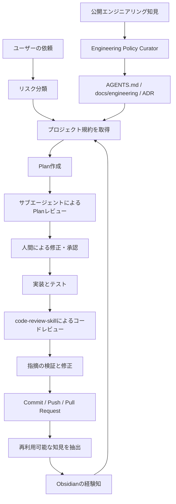
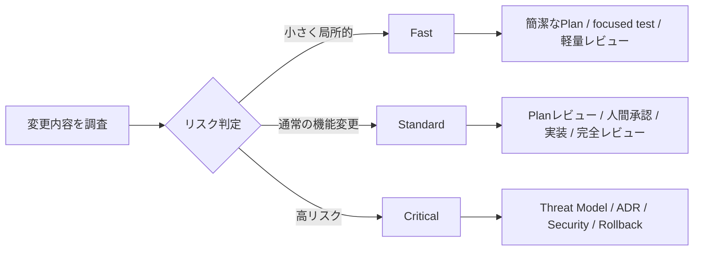
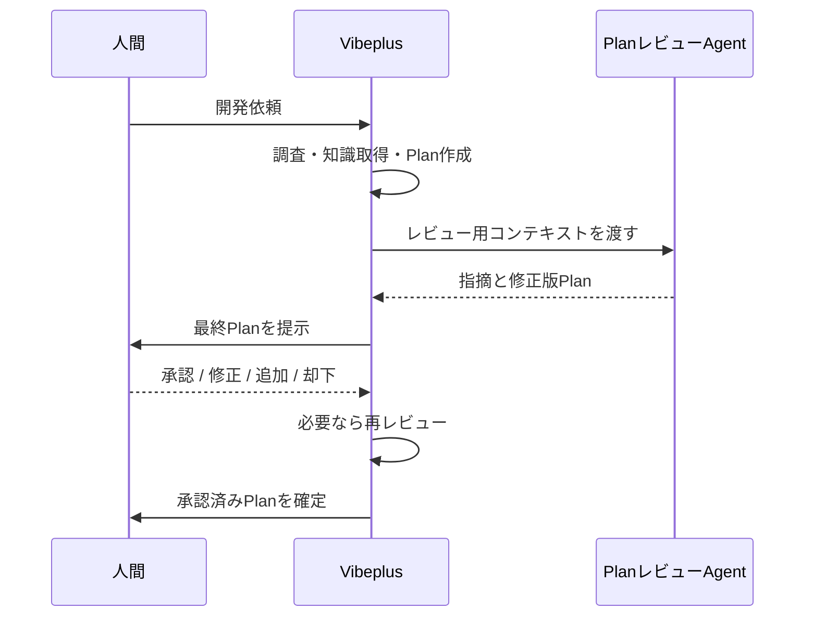
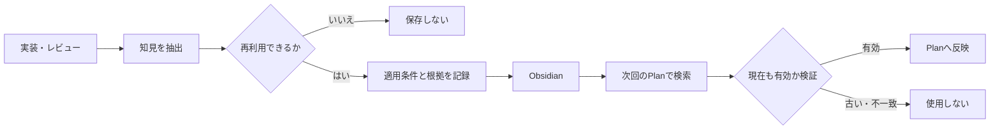

# Vibeplus

Vibeplusは、コーディング依頼を受け取ってからPull Requestを作成し、得られた知見を次回へ活かすまでを支援するCodexプラグインです。

単にコードを生成するのではなく、プロジェクト規約、公開されたエンジニアリング知見、過去の開発経験、人間の判断を組み合わせて開発を進めます。

## 何を解決するか

AIによるコーディングでは、次のような問題が起こりがちです。

- 実装を急ぎ、要件や設計を十分に確認しない
- リポジトリ固有の規約を見落とす
- 過去に起きた失敗を繰り返す
- Planとコードを同じ視点で確認してしまう
- 小さな修正にも重い工程を適用する
- コードは完成しても、判断理由が残らない

Vibeplusは、Plan、独立レビュー、人間承認、実装、テスト、コードレビュー、PR、知識保存を一つの仕組みとして扱います。

## 全体像



## 危険度に応じた実行モード

Vibeplusは、すべての変更へ同じ工程を適用しません。依頼とリポジトリを調査し、根拠付きのリスクシグナルから実行モードを選びます。



### Fast

文言、文書、テストだけの変更や、原因と影響範囲が明確な局所修正に使います。

- 簡潔なPlan
- 人間による短い確認
- focused test
- 変更箇所を中心としたコードレビュー
- 新しい知見がなければObsidian保存を省略

### Standard

通常の機能追加や、複数ファイルにまたがる変更に使います。

- プロジェクト規約とObsidian知識を確認
- 詳細なPlan
- サブエージェントによるPlanレビュー
- 人間による修正・承認
- 実装と各種テスト
- `code-review-skill`によるレビュー
- Pull Request作成
- Obsidianへの知識保存

### Critical

認証、認可、決済、秘密情報、個人情報、不可逆なデータ変更、本番権限などに使います。

Standardの工程に加えて、次を要求します。

- Threat Model
- Architecture Decision Record
- security-focused review
- migration、rollout、rollback計画
- 本番環境で確認するメトリクスとsmoke test
- 実装承認とは別のrelease承認

AIは調査中に新しいリスクを発見した場合、自動的に上位モードへ変更できます。下位モードへ変更するには、人間の明示的な承認が必要です。

## 人間が意思決定に参加する

Vibeplusは、Planを作成してすぐ実装を始めません。



人間は次を選択できます。

- **承認**: 現在のPlanで実装する
- **修正**: 設計、手順、変更範囲、優先順位を変更する
- **追加**: 要件、制約、テストを追加する
- **却下**: Planを破棄または作り直す

Criticalでは人間承認を省略できません。

## 仮想シニアエンジニア規約

`engineering-policy-curator`は、公開知見をプロジェクトへ適用できる規約に変換します。

初期sourceは次の3つです。

- Microsoft Engineering Playbook
- Google Engineering Practices
- Architecture Decision Record

公開リポジトリを毎回すべてAIへ読ませるのではなく、必要な知見だけを抽出します。

```text
AGENTS.md
docs/engineering/
├── index.md
├── principles.md
├── planning.md
├── testing.md
├── code-review.md
├── security.md
├── reliability.md
├── delivery.md
├── decisions.md
├── sources.md
└── adr/
    └── template.md
```

### 規約の優先順位

```text
最新の人間による明示的な指示
  > 法令・セキュリティ・データ保護
  > 承認済みADR
  > 最寄りのAGENTS.md
  > docs/engineeringの承認済み規約
  > 検証済みObsidian知識
  > 固定された公開Playbook
  > AIの一般知識
```

公開知見から生成した規約はドラフトです。人間が承認するまで正式規約にはなりません。

## Obsidianによる学習

Vibeplusは、実装とレビューから得た再利用可能な知識をObsidianへ保存します。



保存対象:

- 有効だった設計判断と成立条件
- リポジトリ固有の規約や制約
- 再発しやすい失敗と修正方法
- レビューで発見した見落とし
- 有効だったテストや検証コマンド

保存しないもの:

- 単なる作業日誌
- 一時的な状態
- 根拠のない推測
- 秘密情報、token、個人情報、機密ログ

Vaultはユーザー指定を優先し、未指定の場合は`OBSIDIAN_VAULT_PATH`を参照します。

```powershell
$env:OBSIDIAN_VAULT_PATH = "C:\Users\you\Documents\ObsidianVault"
```

## 独立したレビュー

Planレビューとコードレビューには別のサブエージェントを使います。

レビューAgentへ会話履歴全体を渡すのではなく、専用のコンテキストパケットを作ります。

```text
レビューコンテキスト
├── 目的と受け入れ条件
├── 対象外
├── AGENTS.mdとプロジェクト規約
├── 関連コードと行番号
├── Planまたは最新diff
├── テスト結果
├── 関連するObsidian知識
├── 未確定事項
└── 期待する出力形式
```

コードレビューには同梱した`code-review-skill`を使用します。対象の言語、フレームワーク、変更内容に関係するreferenceだけを段階的に読み込みます。

## インストール

このディレクトリをCodexプラグインとして配布またはインストールします。

```text
vibeplus-plugin/
├── .codex-plugin/plugin.json
├── skills/
│   ├── vibeplus/
│   ├── engineering-policy-curator/
│   └── code-review-skill/
├── scripts/
├── tests/
└── vendor/
```

インストール後の依頼例:

```text
$vibeplusを使って、ログインAPIにrate limitを追加してPRを作成してください。
```

```text
$engineering-policy-curatorを使って、このリポジトリ向けの開発規約を作成してください。
```

## 公開知見を同期する

Curatorの公開知見はcommitで固定されています。

```powershell
python skills/engineering-policy-curator/scripts/sync_sources.py
```

特定sourceだけを取得する場合:

```powershell
python skills/engineering-policy-curator/scripts/sync_sources.py `
  --source google-engineering-practices
```

上流に更新があるか確認する場合:

```powershell
python skills/engineering-policy-curator/scripts/check_policy_drift.py
```

上流更新が見つかっても、プロジェクト規約を自動変更しません。source更新、影響分析、規約差分、人間レビューを経て取り込みます。

## code-review-skillの更新

`code-review-skill`も上流commitへ固定されています。

```powershell
python scripts/update_code_review_skill.py
```

GitHub Actionsは週次で上流を確認し、更新があれば検証後にPull Requestを作成します。自動的に最新版へ切り替えないため、上流変更による突然の挙動変更を防げます。

## 検証

配布構成を検証します。

```powershell
python scripts/validate_distribution.py
```

リスクルーターの回帰テストを実行します。

```powershell
python -m unittest discover -s tests -v
```

現在テストしている代表ケース:

- 表示だけの変更がFastになる
- 複数moduleの変更がStandardになる
- 認証境界の変更がCriticalへ強制昇格する
- AIがCriticalからStandardへ自動降格できない
- 根拠となるシグナルなしでFast判定できない

## 安全設計

- 無関係なユーザー変更を戻さない、commitしない
- デフォルトブランチとの差分だけでなくcommit履歴も確認する
- 秘密情報をレビューAgent、PR、Obsidianへ渡さない
- 外部Skillと公開知見をcommit固定する
- 規約、Plan、Critical変更には人間の承認を置く
- 実行できなかったテストを成功と記載しない
- GitHub認証に失敗した場合、存在しないPR URLを生成しない

## ライセンスと第三者ソフトウェア

同梱する`code-review-skill`のライセンスと固定revisionは、[THIRD_PARTY_LICENSES.md](THIRD_PARTY_LICENSES.md)および`vendor/code-review-skill.version.yml`を参照してください。

公開エンジニアリング知見は配布物へ丸ごと同梱せず、source catalogにrepository、commit、licenseを記録しています。派生規約を作成する際も、`docs/engineering/sources.md`へ出典を残してください。

## 設計思想

Vibeplusの目的は、すべての変更へ最大の工程を適用することではありません。

```text
小さな変更は軽く速く
通常の変更は体系的に
危険な変更は慎重に
判断理由は人間が確認できる形で残す
実際に得た知識を次回へ活かす
```

人間が方針を決め、AIが調査、計画、実装、検証、記録を担います。
